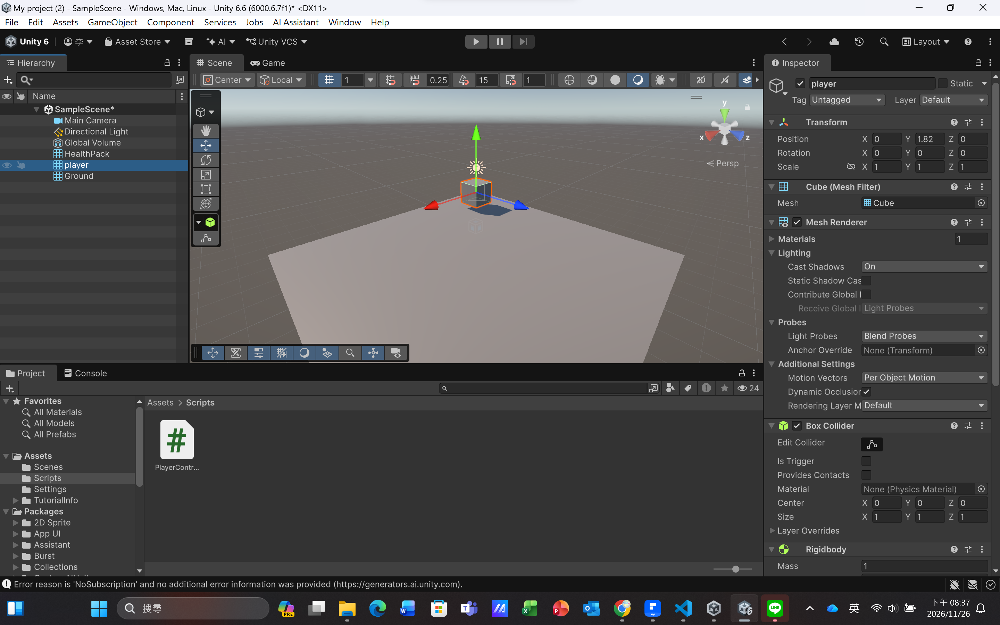
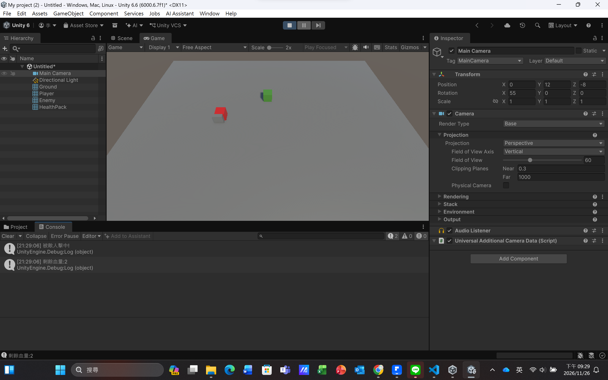
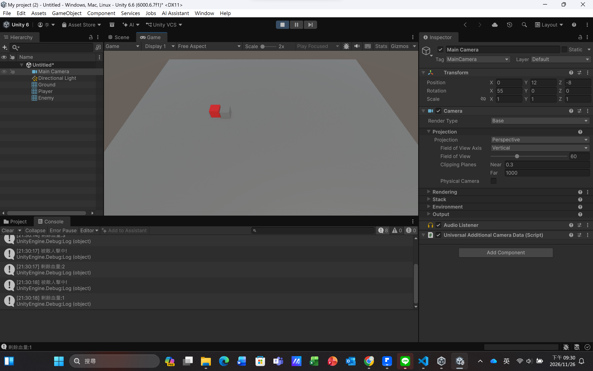

# 第3次練習題目-隨堂-QZ3
>
>學號：113111123
><br />
>姓名：李毓倩
><br />
>作業撰寫時間：180mins
><br />
>最後撰寫文件日期：2026/11/26 
>

1.
Ans:
## 一、題目說明

第 11 章 11.1~11.5 的內容是:

- 建立敵人(Cube + Collider + Tag)
- 讓敵人自動巡邏(`EnemyController.cs`)
- 兔子碰到敵人時扣 1 血(`PlayerController.cs` 的 `OnTriggerEnter`)


---

## 二、完整製作步驟

### 步驟 1:建立補包的基本形狀(對應 11.1)

1. 在 Hierarchy 空白處按右鍵 → **3D Object → Cube**,建立立方體。
2. 將名稱改為 **`HealthPack`**。
3. 建立**綠色** Material(Project 視窗右鍵 → Create → Material,顏色設為綠色),拖曳套用到 HealthPack。
   - *補充說明:* 敵人是紅色、補包是綠色,玩家一眼就能分辨「危險」與「有益」。
4. 用縮放工具(R 鍵)調整大小,大約比兔子小一點。
5. 用移動工具(W 鍵)把它放在兔子的行進路線上。
6. 檢查 Inspector 中的 **Box Collider**,並勾選 **Is Trigger**。
   - *補充說明:* `OnTriggerEnter` 只有在「其中一方勾選 Is Trigger」且「至少一方有 Rigidbody」時才會觸發。兔子身上原本已有 Rigidbody 與 Collider(做金幣、敵人時已設定),所以補包只需勾 Is Trigger 即可。
7. 設定 Tag:Inspector 最上方 **Tag → Add Tag… → 按「+」→ 輸入 `HealthPack` → Save**,回到 HealthPack 物件,把 Tag 下拉選成 **`HealthPack`**。
   - *補充說明:* 程式是靠 Tag 判斷「撞到的是什麼」,所以 Tag 一定要建立並實際指定給物件。


### 步驟 2:補包要不要移動?(對應 11.2、11.3)

題目說「設定跟敵人一樣」,有兩種做法:

| 做法 | 操作 |
|---|---|
| 補包也要來回巡邏 | 選取 HealthPack → Inspector → **Add Component** → 搜尋 **EnemyController** → 加入;可調整 Speed、Patrol Distance |
| 補包固定不動 | 不用附加任何腳本 |

- *補充說明:* `EnemyController.cs` 只負責「來回移動」,與敵人/補包的身分無關,所以**腳本可以直接重用,不需要重寫**。這就是「元件化」的好處。
- 若選擇巡邏,要注意補包移動時仍會一直保持 Is Trigger,碰到兔子時才會觸發。

### 步驟 3:測試補包移動(對應 11.4)

1. 按下**播放**按鈕。
2. 觀察補包:若有掛 `EnemyController`,應該會來回巡邏;若沒掛,應固定不動。
3. 速度太快就降低 Speed、範圍太小就增加 Patrol Distance。

### 步驟 4:修改 PlayerController.cs(對應 11.5,本題重點)

開啟 `PlayerController.cs`,在 `OnTriggerEnter` 中,**照著 Enemy 的寫法再加一段 `HealthPack` 的判斷**:

```csharp
using System.Collections;
using System.Collections.Generic;
using UnityEngine;

public class PlayerController : MonoBehaviour
{
    public float speed = 5f;
    public int score = 0;
    public int health = 3;   // 生命值

    //...其他程式碼(移動、跳躍等)...

    private void OnTriggerEnter(Collider collision)
    {
        // 金幣:加 10 分
        if (collision.gameObject.tag == "Coin")
        {
            Debug.Log("獲得金幣!");
            score = score + 10;
            Destroy(collision.gameObject);
        }

        // 敵人:扣 1 血
        if (collision.gameObject.tag == "Enemy")
        {
            Debug.Log("被敵人擊中!");
            health = health - 1;
            Debug.Log("剩餘血量:" + health);

            if (health <= 0)
            {
                Debug.Log("遊戲結束!");
            }
        }

        // 新增:補包,加 1 血
        if (collision.gameObject.tag == "HealthPack")
        {
            Debug.Log("獲得補包!");
            health = health + 1;
            Debug.Log("目前血量:" + health);
            Destroy(collision.gameObject);   // 吃掉補包,避免重複加血
        }
    }
}
```



**程式碼逐行說明:**

- `collision.gameObject.tag == "HealthPack"`:判斷撞到的物件 Tag 是否為 `HealthPack`(拼字、大小寫必須與 Inspector 完全一致)。
- `health = health + 1;`:血量加 1(敵人是 `health - 1`,這就是唯一的邏輯差異)。
- `Destroy(collision.gameObject);`:把補包從場景中移除。
  - *補充說明:* 若不 Destroy,兔子停留在補包範圍內或再次碰到,會重複加血,造成血量無限增加。
- 補包不需要檢查 `health <= 0`,因為加血不會導致死亡。

### 步驟 5:測試補包功能

1. 儲存腳本,回到 Unity 等待編譯完成。
2. 按下**播放**。
3. 讓兔子先碰到敵人 → Console 顯示「被敵人擊中!」「剩餘血量:2」。
4. 再讓兔子碰到補包 → Console 顯示「獲得補包!」「目前血量:3」,補包消失。
5. 在 Inspector 觀察 PlayerController 的 **Health** 數值是否隨之變化。

---

## 三、補包與敵人的差異對照

| 項目 | 敵人 Enemy | 補包 HealthPack |
|---|---|---|
| 顏色 | 紅色 | 綠色 |
| Tag | `"Enemy"` | `"HealthPack"` |
| 血量變化 | `health - 1` | `health + 1` |
| 碰到後 | 敵人還在場景中 | `Destroy` 把它吃掉 |
| 是否檢查死亡 | 要(`health <= 0`) | 不用 |
| 移動腳本 | `EnemyController` | 可選擇重用 `EnemyController` 或不掛 |

---

## 四、常見錯誤與補充說明

1. **Tag 沒建立或拼錯**:`"HealthPack"` 大小寫、拼字必須與 Inspector 完全一致,否則程式不會有反應。
2. **補包忘記設 Tag**:程式寫對了也不會觸發,因為物件 Tag 仍是 Untagged。
3. **忘記勾 Is Trigger**:`OnTriggerEnter` 不會觸發(兔子會被擋住而不是穿過)。
4. **忘記 `Destroy`**:血量會被重複增加。
5. **腳本沒存檔或有編譯錯誤**:Unity 的 Console 會顯示紅字,需先修正才能播放。

### 進階:設定血量上限(可選)

若不希望血量無限增加,可限制最多 3 血:

```csharp
health = Mathf.Min(health + 1, 3);  // 最多 3 血
```

`Mathf.Min(a, b)` 會回傳兩者較小的值,所以血量加到 3 之後就不會再增加。

---

## 五、將 answer.md 轉換成 answer.pdf(VS Code)

1. 用 VS Code 開啟 `answer.md`。
2. 先安裝擴充套件 **Markdown PDF**(左側「擴充功能」搜尋 `Markdown PDF`,按安裝)。
3. 點選上方選單 **檢視(View)→ 命令選擇區(Command Palette)**,彈出對話框(快速鍵:Windows `Ctrl+Shift+P`,Mac `Cmd+Shift+P`)。
4. 在對話框輸入 **`Markdown PDF: Export (pdf)`** 並選擇。
5. 等待轉換完成,資料夾中會產生 **`answer.pdf`**(檔名需為 `answer.pdf`)。
6. 開啟 `answer.pdf` 確認內容、程式碼與表格皆正常顯示。

---

## 六、結論

新增補包的重點只有三件事:**換 Tag(`HealthPack`)、改加號(`health + 1`)、吃掉它(`Destroy`)**。其餘建立物件、Collider、Is Trigger、巡邏腳本重用,皆與敵人流程相同。


## 其他 
心得:這次練習讓我學會調整物件的顏色設定。一開始物件與程式同時執行時,常常出現當機的情況,後來調整顏色後,運行變得比較穩定,當機的次數也明顯減少。這讓我體會到,即使是看似很小的設定,也可能影響整體程式的表現。未來遇到類似問題時,我會先檢查這類基本設定,再逐步找出原因。